# Jeff Sia Yu Heng · 谢宇恒

[Portfolio](https://founder.onotape.one/) · [LinkedIn](https://www.linkedin.com/in/sia-yu-heng-jeff/) · [Email](mailto:siayuhengjeff@gmail.com)

I build AI systems from the first conversation to production at altShift. I work across retrieval, evaluation, and full-stack delivery, with a focus on how people verify and use the results.

**Nilai University Valedictorian · Class of 2026**  
Bachelor of Software Engineering · CGPA 3.82 · Best Student Award

## ONOTAPE

A private digital cassette library with two sides, finite capacity, and tactile playback. Make a tape, keep it, or give it away. [Explore ONOTAPE →](https://onotape.one/)

## Selected work

### Enterprise AI Chatbot
Built and deployed an internal knowledge assistant using retrieval-augmented generation. Worked from document ingestion and vector search through model integration, interface design, and testing.

### Financial Consolidation & Reconciliation
Built workflows to consolidate records across locations, reconcile sales and purchases, match bank transactions, and produce trial balance and profit-and-loss reports.

### Fishture
Prototyped an AI fishing companion in three hours. Top 5 at the March 2026 GDG / Google DeepMind Hackathon.

## GitHub activity

Unique commits credited to me on the default branches of my private repositories over 30 UTC days. The card shows the total and snapshot date.

## More milestones

- Delivered the Nilai University graduating-class address on 26 September 2026.
- At Hiredly, combined Cypress and AI-assisted workflows to expand candidate-tracking system test coverage to 87%.
- Served as Jarvis Technology Club president and Student Representative Council vice president.
